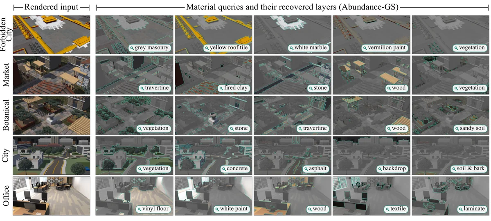

# Spectral World Renderer

### Towards Verifiable 3D Hyperspectral Unmixing

**Chia-Ming Lee<sup>1,2</sup> · Yu-Jou Hsiao<sup>3</sup> · Ming-Ching Chang<sup>1</sup> · Xin Li<sup>1</sup> · Yu-Lun Liu<sup>2</sup> · Chih-Chung Hsu<sup>2,3</sup>**

<sup>1</sup>University at Albany, State University of New York · <sup>2</sup>National Yang Ming Chiao Tung University · <sup>3</sup>National Cheng Kung University

[**Project page**](https://ming053l.github.io/Spectral-World-Renderer/) · [Paper + supplement (PDF)](docs/assets/paper.pdf) · [Overview video](https://www.youtube.com/watch?v=5eKuSb7DITo) · Code (coming soon)



**Spectral World Renderer** generates indoor and outdoor hyperspectral worlds whose material composition is known by construction. A coding agent turns reference images and text into executable scene programs; measured spectra and shared sub-pixel rendering samples then yield aligned hyperspectral observations, material labels and area proportions, so that a 3D decomposition can be verified.

**SWR-Bench** comprises eight indoor and outdoor worlds with material and illumination variation, rendered with 64 bands from 420 to 980 nm.

**Abundance-GS** decodes abundances over a shared endmember dictionary at every ray intersection of a compact Gaussian representation, so every primitive carries queryable abundances. A multi-view appearance regularization assigns endmembers to distinct appearances without material labels.

- Best or on-par material identification in all eight worlds (Table 2).
- Complete City pipeline in 6 min 37 s; 34.9 labelled views/s with spectra and label maps.
- 3.7–12.9× faster training than the unmixing baselines.
- Highest PSNR on each real-capture source (NeSpoF, HSI-SC, HS-NeRF).

## Repository contents

This repository hosts the project page, the paper, the supplementary material and rendered clips. Research code and datasets are not part of this release.

```
docs/
  index.html, style.css, app.js   static page, no build step
  assets/fig/                      paper figures rasterized for the web (WebP)
  assets/video/                    poster frame of the overview video (hosted on YouTube)
  assets/query/                    material-query clips (720p) per world and material
  assets/tetra/                    bounding-tetrahedra clips (720p)
  assets/worlds/                   SWR-Bench world thumbnails
```

## Local preview

```bash
python -m http.server 8000 --directory docs
```

Then open <http://localhost:8000>. GitHub Pages deploys `docs/` through `.github/workflows/pages.yml` on every push to `main` that changes `docs/`; in **Settings → Pages**, the source must be **GitHub Actions**.

## Citation

```bibtex
@article{lee2027swr,
  title   = {Spectral World Renderer: Towards Verifiable 3D Hyperspectral Unmixing},
  author  = {Lee, Chia-Ming and Hsiao, Yu-Jou and Chang, Ming-Ching and
             Li, Xin and Liu, Yu-Lun and Hsu, Chih-Chung},
  journal = {Preprint, under review},
  year    = {2026}
}
```

## Acknowledgements

Website layout adapted from the [Nerfies](https://nerfies.github.io/) template, as used by [LongSplat](https://linjohnss.github.io/longsplat/).
