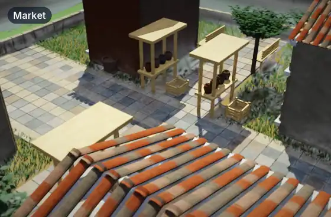
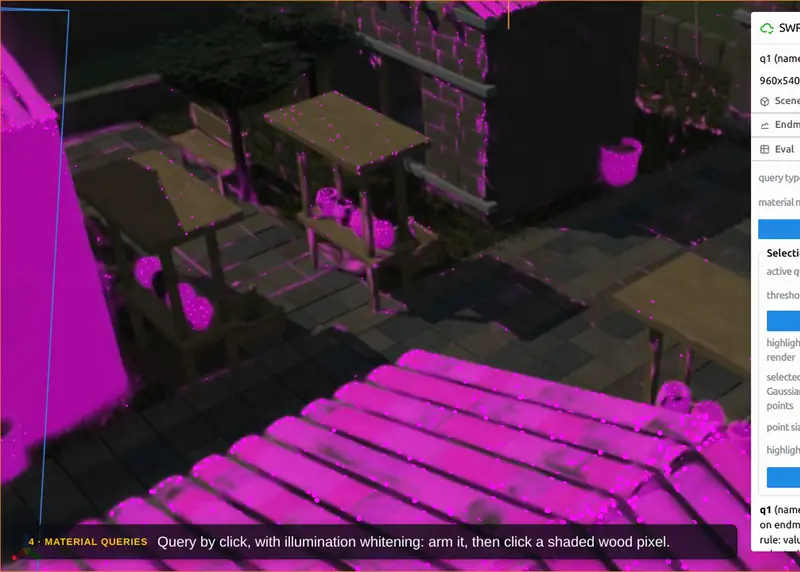

<div align="center">

# Spectral World Renderer

### Unified 3D Hyperspectral Unmixing

**[Chia-Ming Lee](https://ming053l.github.io/)<sup>1,2</sup> · Yu-Jou Hsiao<sup>3</sup> · [Ming-Ching Chang](https://mingching.github.io/)<sup>1</sup> · [Xin Li](https://scholar.google.com/citations?user=gMBvzGoAAAAJ&hl=en)<sup>1</sup> · [Yu-Lun Liu](https://yulunalexliu.github.io/)<sup>2</sup> · [Chih-Chung Hsu](https://cchsu.info/)<sup>2,3</sup>**

<sup>1</sup>University at Albany, State University of New York · <sup>2</sup>National Yang Ming Chiao Tung University · <sup>3</sup>National Cheng Kung University

[](https://ming053l.github.io/Spectral-World-Renderer/)
[](https://arxiv.org/pdf/2610.19520)
[](https://arxiv.org/abs/2610.19520)
[](https://www.youtube.com/watch?v=3FrSH7MaSjU)
[](code/)
[](https://huggingface.co/datasets/ming0531/SWR-Bench)

**See what a 3D scene is made of, not only how it looks.**



</div>

## Overview

Cameras and RGB-based 3D models record colour, so surfaces of the same colour but different composition, such as a green-painted panel and a leaf, look alike. Hyperspectral images separate them, but scenes with known material composition are rare, so a 3D decomposition is hard to verify. Spectral World Renderer unifies world generation, rendering and unmixing: it generates worlds of known composition and unmixes inside rendering, so one render of a Gaussian scene yields spectra and material abundances that can be verified and queried.

- **The SWR world generator** produces indoor and outdoor hyperspectral worlds whose material composition is known by construction. A coding agent turns reference images and text into executable scene programs; measured spectra and shared sub-pixel rendering samples then yield aligned hyperspectral observations, material labels and area proportions.
- **SWR-Bench** comprises eight indoor and outdoor worlds with material and illumination variation, rendered with 64 bands from 420 to 980 nm.
- **SWR** decodes abundances over a shared endmember dictionary at every ray intersection of a compact Gaussian representation, so every primitive carries queryable abundances. A multi-view appearance regularization assigns endmembers to distinct appearances without material labels.

## Query any material

Abundances and spectra are stored on explicit, rasterizable Gaussians, so a query is a selection over primitives, consistent across views and free of labels or per-image classifiers.

| Query mode | Example | What it shows |
|---|---|---|
| Material name | `terracotta`, `water`, `wood` | the dominant endmember of each surface |
| Click | a shaded pixel on wood or limestone | the sunlit parts of the same material are retrieved too: 77 % vs 10 % for an RGB colour query (mean over four worlds) |
| Reference spectrum | a living-leaf reflectance from a spectral library | foliage is separated from foliage-coloured minerals (2° apart in RGB, 42° in spectrum) |
| Band index | near-infrared index | materials beyond the visible range |
| Combination | `stone ∨ travertine` | several materials at once |

A spectral query takes about 3 ms.

## Interactive viewer

`abgs viewer` opens a trained scene in the browser, built on [viser](https://github.com/nerfstudio-project/viser) as the nerfstudio viewer is. It renders spectral bands, false-colour composites, abundances and material labels from any camera, runs every query mode above with 3D highlighting, lists the Gaussians along a clicked ray with their weights and abundances, and starts training, evaluation and exports.

<div align="center">
<a href=".github/readme/viewer_highlights.mp4"></a>
<br><sub>A click on shaded wood retrieves every wooden surface, in sun and in shade. <a href=".github/readme/viewer_highlights.mp4">Watch the 35 s highlights</a>.</sub>
</div>

```bash
abgs viewer --scene market                 # http://127.0.0.1:7007
ssh -L 7007:localhost:7007 <server>        # from a laptop, then open http://localhost:7007
```

See [`code/README.md`](code/README.md#viewer) for all tabs and options.

## Results at a glance

| | SWR | Reference |
|---|---|---|
| Material identification on SWR-Bench | best mIoU in all eight worlds | Table 2 |
| City training, full pipeline | **6 min 37 s** | UnMix-NeRF 24 min 17 s · 3DGS+VCA/NNLS 85 min 2 s |
| Rendering with spectra and label maps (960×540×64) | **34.9 views/s**, with our optimized fused fp16 decoder | UnMix-NeRF 0.18 · 3DGS+VCA/NNLS 3.6 |
| Real captures (NeSpoF, HSI-SC, HS-NeRF) | highest PSNR on each source | Table 5 |
| Mineral-leaf query in City | no ordinary tree retrieved | RGB query: eleven ordinary trees |

## Code

The SWR implementation is in [`code/`](code/). See [`code/README.md`](code/README.md) for installation, data roots and the training and evaluation stages; third-party components and their licences are listed in [`code/abundance_gs/third_party/THIRD_PARTY.md`](code/abundance_gs/third_party/THIRD_PARTY.md).

```bash
cd code
env/setup.sh                 # environment, pinned packages and CUDA extensions
abgs run  --scene market --workdir $W     # all stages for one scene (see code/README.md for data roots)
abgs eval --scene market --output $W/eval
```

## Citation

If you find this work useful, please cite:

```bibtex
@misc{lee2026swr,
  title         = {Spectral World Renderer: Unified 3D Hyperspectral Unmixing},
  author        = {Lee, Chia-Ming and Hsiao, Yu-Jou and Chang, Ming-Ching and
                   Li, Xin and Liu, Yu-Lun and Hsu, Chih-Chung},
  year          = {2026},
  eprint        = {2610.19520},
  archivePrefix = {arXiv},
  primaryClass  = {cs.CV},
  url           = {https://arxiv.org/abs/2610.19520}
}
```

## Repository contents

This repository hosts the SWR code, the project page, the paper with its supplementary material, and rendered clips. The SWR-Bench dataset is hosted on Hugging Face: <https://huggingface.co/datasets/ming0531/SWR-Bench>.

```
code/                              SWR: installation, stages, configs and the viewer in code/README.md
docs/
  index.html, style.css, app.js   static page, no build step
  assets/paper.pdf                 paper and supplementary material
  assets/fig/                      paper figures rasterized for the web (WebP)
  assets/video/                    poster frame of the overview video (hosted on YouTube)
  assets/query/                    material-query clips (720p) per world and query
  assets/tetra/                    bounding-tetrahedra clips (720p)
  assets/worlds/                   SWR-Bench world thumbnails
.github/
  workflows/pages.yml              GitHub Pages deployment
  readme/                          README previews (query modes, viewer)
```

## Local preview

```bash
python -m http.server 8000 --directory docs
```

Then open <http://localhost:8000>. Python's built-in server does not answer HTTP range requests, so video seeking may be unreliable locally; GitHub Pages serves ranges. GitHub Pages deploys `docs/` through `.github/workflows/pages.yml` on every push to `main` that changes `docs/`; in **Settings → Pages**, the source must be **GitHub Actions**.

## License

The SWR code is released under the [MIT License](LICENSE). Third-party components in `code/abundance_gs/third_party/` keep their own licences, listed in [`THIRD_PARTY.md`](code/abundance_gs/third_party/THIRD_PARTY.md); this includes the adapted files `code/abundance_gs/scene_loader.py` and `code/abundance_gs/nht/trainer.py`. The components derived from 3D Gaussian Splatting (Inria) are restricted to non-commercial research use.

## Acknowledgements

Website layout adapted from the [Nerfies](https://nerfies.github.io/) template, as used by [LongSplat](https://linjohnss.github.io/longsplat/).
